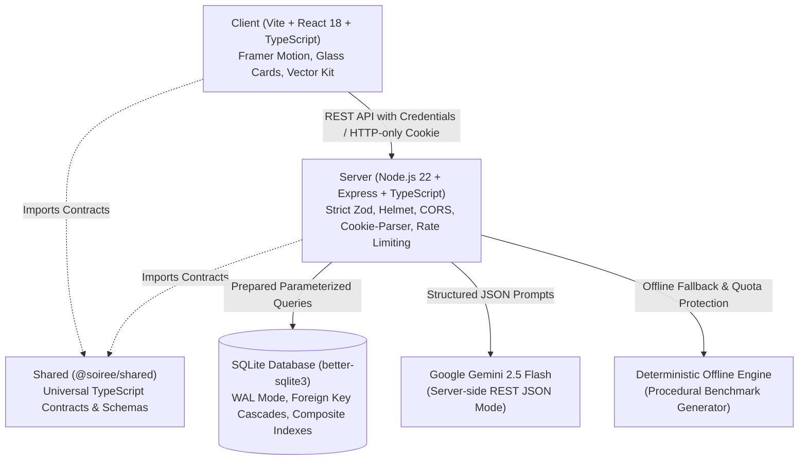

# Soirée — System Architecture & Engineering Design

This document details the software architecture, modular system topology, database design, and data flows of **Soirée**, an enterprise-grade GenAI luxury event planning platform.

---

## 1. High-Level System Topology

Soirée is architected as an **npm workspaces monorepo** consisting of three strictly decoupled packages:

- **`@soiree/shared`**: Universal TypeScript contracts, domain schemas, Zod validators, and shared type definitions.
- **`@soiree/server`**: Node.js & Express REST API powered by SQLite (`better-sqlite3`), Google Gemini GenAI, and an offline procedural fallback generator.
- **`@soiree/client`**: Vite + React 18 single-page application styled with bespoke vanilla CSS, Framer Motion, and procedural SVG vector art.



---

## 2. Monorepo Package Breakdown

### `@soiree/shared` (`shared/`)

- Universal data contracts: `Plan`, `Brief`, `BudgetItem`, `Milestone`, `Vendor`, `IdeaGroup`, `Moodboard`, `Guest`, `User`, `PublicPlanView`.
- Zod schemas: Validation rules for event briefs, guest imports, budget rebalancing proposals, and pagination parameters.
- Currency and status enums: Strict string literal unions preventing runtime invalid states.

### `@soiree/server` (`server/`)

- **App Entry (`src/app.ts`, `src/index.ts`)**: Initializes middleware stack, security guards, body parsers with strict size limits, and production error handlers.
- **Database Layer (`src/db/`)**: Schema definition, foreign key pragmas, WAL mode enablement, composite indexing, and prepared statement caching.
- **Route Modules (`src/routes/`)**: Decoupled, modular controllers for authentication, health, and event plan operations.
- **Services (`src/services/`)**:
  - `ai.ts`: Google Gemini GenAI integration with JSON schema enforcement and heuristic fallback triggers.
  - `generator.ts`: Deterministic procedural benchmark event generator for offline/zero-config operation.
  - `ics.ts`: RFC 5545 compliant iCalendar serialization with 75-octet line folding and character escaping.
- **Utilities (`src/utils/`)**: Text sanitization and HTML entity escaping functions preventing XSS.

### `@soiree/client` (`client/`)

- **Presentation Layer (`src/components/`)**:
  - `Landing.tsx`: Hero with procedural SVG animation, bento features, interactive occasion cards.
  - `Navbar.tsx`: Responsive navigation with accessible mobile drawer, skip-to-content focus routing, and authentication status.
  - `Planner.tsx` & `Wizard.tsx`: 3-step event creation wizard with live budget calculation.
  - `Dashboard.tsx`: User plan management ("My Plans") with quick-delete and creation shortcuts.
  - `PlanView.tsx`: Core plan orchestration hub with modular sub-components.
  - `SharedPlanPage.tsx`: Public read-only view (`/#/share/:token`) sanitized against data leaks.
  - `Vectors.tsx` & `VectorScene.tsx`: Lightweight SVG vector art and procedural particle systems.
- **Plan Subcomponents (`src/components/plan/`)**:
  - `PlanHeader.tsx`: Title, countdown, guest count, share trigger, and `.ics` export button.
  - `PlanOverviewTab.tsx`: Summary, budget snapshot, milestone timeline progress, and vendor summary.
  - `ShareModal.tsx`: Public link management, token regeneration, and privacy disclosure checklist.
- **Modular Lazy Tabs (`src/components/tabs/`)**:
  - `BudgetTab.tsx`: Donut chart, inline budget editing, overspend alerts, and AI Budget Rebalancer modal.
  - `VendorsTab.tsx`: Category pipelines, status tracking, notes, and estimates.
  - `GuestsTab.tsx`: Headcount summary, dietary breakdowns, RSVP tracking, and bulk import modal.
  - `IdeasTab.tsx`: Categorized creative themes, ceremonies, entertainment, and culinary ideas.
  - `MoodboardTab.tsx`: 5-color click-to-copy palette, typography pairings, motifs, decor, and playlist vibes.
  - `AskTab.tsx`: Persistent interactive chat grounded in plan context.

---

## 3. Modular Backend Architecture (`server/src/routes/plans/`)

To prevent monolithic controller anti-patterns, the plan management endpoints are partitioned into specialized sub-routers under `server/src/routes/plans/`:

| Sub-Router     | File            | Responsibility                                                                                                                               |
| :------------- | :-------------- | :------------------------------------------------------------------------------------------------------------------------------------------- |
| **Common**     | `common.ts`     | Verification middleware (`verifyPlanOwnership`), plan fetching helpers, shared DB queries.                                                   |
| **Budget**     | `budget.ts`     | Patching budget items, calculating category deficits, generating rebalance proposals, and applying rebalance changes in atomic transactions. |
| **Guests**     | `guests.ts`     | Guest CRUD operations, bulk import parsing (up to 500 lines), dietary summaries, and headcount analytics.                                    |
| **Milestones** | `milestones.ts` | Milestone completion toggles and schedule updates.                                                                                           |
| **Vendors**    | `vendors.ts`    | Vendor category additions, status updates, estimate management, and deletions.                                                               |
| **Ideas**      | `ideas.ts`      | Creative idea generation and prompt-steered regeneration.                                                                                    |
| **Moodboard**  | `moodboard.ts`  | 5-color palette generation, motif updates, and moodboard steering.                                                                           |
| **Share**      | `share.ts`      | Generating 24-character URL-safe public tokens, share toggling, and link revocation.                                                         |
| **Chat**       | `chat.ts`       | Persistent chat message history retrieval and AI assistant response generation.                                                              |
| **Export**     | `export.ts`     | RFC 5545 `.ics` iCalendar calendar downloads with milestone deadlines.                                                                       |

---

## 4. Database Architecture & Schema Design

Soirée uses SQLite via `better-sqlite3` with strict relational constraints:

### Pragma Optimizations

- `PRAGMA foreign_keys = ON`: Enforces referential integrity with cascading deletes across plans, budget items, milestones, vendors, ideas, moodboards, guests, and chat logs.
- `PRAGMA journal_mode = WAL`: Write-Ahead Logging delivers concurrent readers without locking the writer.
- `PRAGMA synchronous = NORMAL`: Balances durability with write throughput.

### Composite Indexes

- `idx_plans_user_id`: Fast retrieval of user celebration lists.
- `idx_plans_share_token`: Sub-millisecond lookup for public shared plan views.
- `idx_budget_plan_id`: High-performance category querying and spend aggregations.
- `idx_milestones_plan_id`: Fast timeline order sorting.
- `idx_vendors_plan_id`: Optimized vendor category queries.
- `idx_guests_plan_status`: Rapid aggregation of RSVPs and confirmed headcount.
- `idx_chat_plan_created`: Sequential timeline retrieval of assistant conversations.

---

## 5. Dual GenAI Engine: Online Gemini + Deterministic Offline Generator

```
                ┌───────────────────────────────────┐
                │        Client Brief / Prompt       │
                └─────────────────┬─────────────────┘
                                  │
                                  ▼
                ┌───────────────────────────────────┐
                │   GEMINI_API_KEY Configured?      │
                └─────────┬───────────────────┬─────┘
                     Yes  │                   │ No
                          ▼                   ▼
             ┌─────────────────────────┐  ┌─────────────────────────┐
             │   Google Gemini 2.5     │  │  Deterministic Offline  │
             │   JSON Schema Mode      │  │  Benchmark Generator    │
             └────────────┬────────────┘  │  (Industry Calibrated)  │
                          │               └───────────┬─────────────┘
                          │ (On error / quota)        │
                          └──────────► ◄──────────────┘
                                       │
                                       ▼
                          ┌─────────────────────────┐
                          │ Validated Fullstack     │
                          │ Celebration Plan (DB)   │
                          └─────────────────────────┘
```

1. **Google Gemini JSON Schema Mode**: Calls specify `responseMimeType: "application/json"`, enforcing exact mathematical budgets, valid 7-character hex colors (`/^#[0-9a-f]{6}$/i`), and realistic lead times.
2. **Deterministic Offline Generator (`generator.ts`)**:
   - Zero-dependency procedural synthesis based on benchmark celebration formulas (Indian/Western weddings, milestone birthdays, community festivals).
   - Occasion-specific palettes, typography pairings, motifs, and playlist vibes derived mathematically from brief inputs.
   - Proportional budget rebalancing algorithm guaranteeing zero negative headroom and strict preservation of contingency reserves.

---

## 6. Frontend State & Performance Engineering

- **Route & Tab Lazy-Loading**: Dynamic chunking splits the bundle into sub-18 KB assets loaded on demand with fallback `<LoopingLotus />` placeholders.
- **Layout Stability (CLS = 0.000)**: Layout space is pre-reserved for hero media (`min-height: 100svh`), copy (`min-height: 380px`), and lazy tabs (`.tab-content-area { min-height: 520px; contain: layout; }`).
- **Debounced Mutations & Optimistic UI**: Budget item adjustments and milestone toggles apply optimistically in React state, syncing to SQLite via debounced 450ms timers with automatic rollback on error.
- **Background Throttling**: CSS animations and SVG loops pause when `document.hidden` is true via `.tab-hidden` class, saving CPU cycles and battery.
