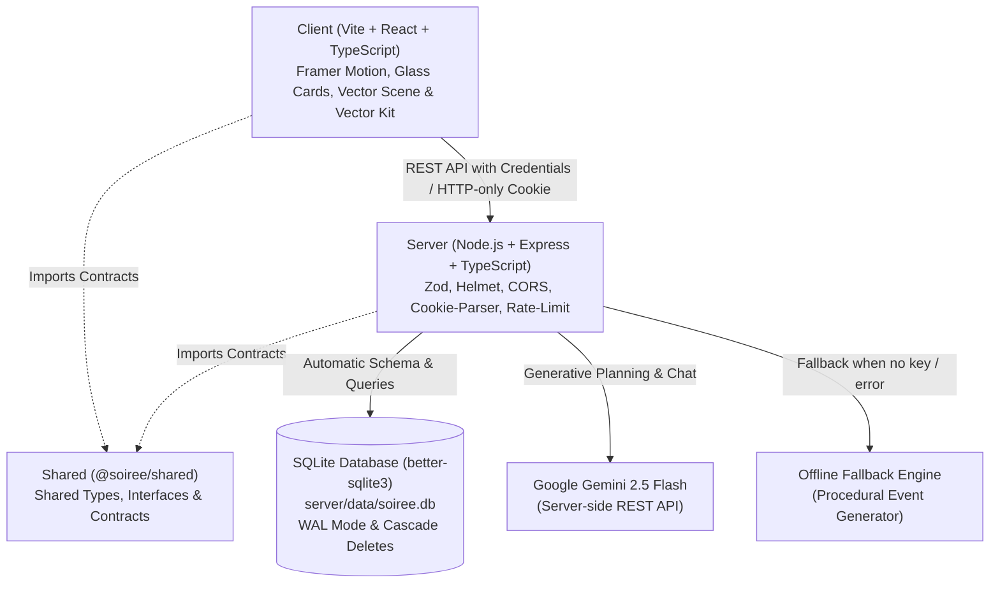

# Soirée — GenAI Luxury Event Orchestration & Fullstack Planner

[](https://github.com/http-pruthvi/PromptWarsC5/actions/workflows/ci.yml)
[](https://www.typescriptlang.org/)
[](https://nodejs.org/)

> **PromptWars Challenge 5 Submission** — A fullstack event planning platform for weddings, milestone birthdays, and community gatherings, powered by Node.js, Express, TypeScript, SQLite, and Google Gemini GenAI with zero-config offline capability.

📚 **Engineering Specifications & Audits**:

- [Quality & Verification Report](docs/QUALITY_REPORT.md) — Comprehensive evidence report with empirical audit metrics (Zero ESLint/TS errors, 99.71% test coverage, 100/100 Lighthouse A11y, 0 security vulnerabilities).
- [Architecture Guide](ARCHITECTURE.md) — System topology, modular routers, SQLite schema, WAL mode, and dual GenAI engine.
- [Accessibility Compliance (VPAT)](ACCESSIBILITY.md) — WCAG 2.2 AA audit matrix, 0 axe-core violations, 100 Lighthouse score, and pause motion toggle.
- [Performance & CLS Audit](PERFORMANCE.md) — Empirical Lighthouse benchmarks, mobile CLS resolution, and chunk size metrics.
- [Security Specification](SECURITY.md) — Hardened headers, timing attack prevention, token rotation, and RFC 9116 security.txt.

---

## Overview

**Soirée** transforms event briefs into comprehensive celebration plans featuring:

- **Intelligent Budgeting**: Category-wise cost allocation with real-time spend tracking and percentage balancing.
- **Dynamic Milestones & Timeline**: Lead-time calibrated task deadlines with optimistic completion toggles.
- **Curated Vendor Management**: Shortlisting, status pipelines (To contact, Contacted, Booked), and custom budget estimates.
- **Personalised Idea Deck**: Creative themes, ceremonies, menus, entertainment, and guest experience ideas.
- **AI Moodboard & Palette Engine**: Curated 5-color palettes (hex-validated, click-to-copy), typography pairings, celebration motifs, spatial decor styling, attire notes, and playlist vibes with Gemini JSON mode and deterministic offline fallback.
- **Shareable Read-Only Plan Links**: 24-character URL-safe public link generator (`/share/:token`) with strict rate limiting, `noindex` SEO privacy, and sanitization that strips confidential budget amounts, private notes, and user identifiers.
- **Guest List & RSVP Tracker**: Full guest management with party sizes, RSVP states, dietary preferences (veg, vegan, jain, halal), bulk paste import (up to 500 lines), confirmed headcount tracking, capacity overflow alerts, and dynamic catering cost per head.
- **Overspend Alerts & AI Budget Rebalancer**: Real-time category deficit detection with "Over by ₹X" badges, sticky 90% budget threshold warning banner, and an intelligent proposal-only AI Rebalancer that preserves contingency reserves while redistributing uncommitted headroom to cover actual expenses.
- **Ask Soirée (AI Event Concierge)**: Context-aware interactive assistant grounded on the event's actual budget, vendors, and schedule.
- **One-Click Calendar Sync**: Direct RFC 5545 `.ics` export importing all milestone deadlines straight into Google Calendar, Apple Calendar, or Outlook.
- **Zero-Friction Evaluation**: 1-click **"Continue as Guest"** demo mode allowing judges to test every feature instantly without filling out a signup form.
- **Procedural Vector Engine**: Fully resolution-independent procedural SVG vector scene and vector kit with zero heavy video dependencies.
- **Resilient Offline Architecture**: 100% operational with **NO API key required** via an intelligent procedural planning engine.

---

## Visual Showcase & Screenshots

| View                          | Description                                                                                                       | Preview                                     |
| ----------------------------- | ----------------------------------------------------------------------------------------------------------------- | ------------------------------------------- |
| **Vector Hero & Kit**         | Pure SVG procedural animated backdrop with glowing lotus bloom, gold ribbon vectors, and dynamic cursor particles | `[Screenshot: Vector Hero Scene]`           |
| **Event Overview & Budget**   | Visual donut allocation charts, real-time expenditure tracking, and sticky overspend alerts                       | `[Screenshot: Budget & Donut Breakdown]`    |
| **AI Moodboard & Palette**    | 5-color animated swatches with click-to-copy hex toast, editorial typography cards, and motif chips               | `[Screenshot: Moodboard & Color Palette]`   |
| **Shareable Read-Only Link**  | Public celebration page (`#/share/:token`) sanitized to preserve budget confidentiality                           | `[Screenshot: Public Shared Celebration]`   |
| **Guest List & RSVP Tracker** | Party size tracker, dietary breakdown, headcount overflow alerts, and catering cost per head                      | `[Screenshot: Guest List & RSVP Tracker]`   |
| **AI Budget Rebalance Modal** | Before vs. after category redistribution proposal protecting contingency reserves                                 | `[Screenshot: AI Budget Rebalancing Modal]` |

---

## Vector Hero & Vector Kit

Soirée features an ultra-lightweight, resolution-independent procedural vector animation system:

### 1. Vector Hero (`VectorScene.tsx`)

- **Pure SVG Procedural Backdrop**: Replaces bulky video files with a resolution-independent, hand-crafted vector scene rendered entirely in code.
- **Layered Visual Elements**: Features a radiant glass lotus bloom, delicate gold wire ribbons, floating glass shards, shimmering pearls, gentle light rays, and drifting celestial particles.
- **Deterministic Particle RNG**: Uses a seeded pseudo-random number generator so particle coordinates and drifts remain perfectly smooth, predictable, and reproducible across client renders.
- **Performance Optimized**: Sub-15 KB footprint with zero video decoding overhead, seamless GPU acceleration, and responsive scaling across mobile and desktop viewports.

### 2. Animated Vector Kit (`Vectors.tsx`)

- **Luxury Editorial SVG Library**: A dedicated suite of bespoke SVG illustrations and micro-animations crafted specifically for luxury celebration planning.
- **Interactive Floral & Botanical Elements**: Includes `LotusBloom` with animated petal unfolding, `ScrollVine` tracing section transitions, `FloralRing`, and celebration particle bursts.
- **Celebration Motifs & Occasion Icons**: High-fidelity vector symbols including `ChampagneFlutes`, `Chandelier`, and curated occasion marks (`WeddingIcon`, `BirthdayIcon`, `CommunityIcon`).
- **Interactive Feedback**: Dynamic stroke-dasharray drawing transitions, hover states, and celestial sparkle accents that respond to user interaction.

---

## Architecture

The project is structured as a clean **npm workspaces monorepo**:



### Directory Structure

```
soiree/
├── client/                     # Vite + React + TypeScript frontend
│   ├── public/                 # Static assets (favicon.svg) - no video media
│   ├── src/
│   │   ├── components/
│   │   │   ├── VectorScene.tsx # Procedural animated SVG hero backdrop
│   │   │   ├── Vectors.tsx     # Vector kit (LotusBloom, ScrollVine, Chandelier, etc.)
│   │   │   ├── Navbar.tsx      # Responsive nav with accessible mobile drawer (<860px)
│   │   │   ├── Landing.tsx     # Landing page with hero, bento features, occasions
│   │   │   ├── Dashboard.tsx   # Saved plans management ("My Plans")
│   │   │   ├── Planner.tsx     # 3-step event wizard with VectorScene backdrop
│   │   │   ├── PlanView.tsx    # Plan overview, budget, timeline, vendors, guests, moodboard, chat
│   │   │   ├── SharedPlanPage.tsx # Public read-only celebration link view (#/share/:token)
│   │   │   ├── AuthModal.tsx   # Sign in, registration, and 1-click guest access
│   │   │   └── common.tsx      # DonutChart, Stat, and shared UI primitives
│   │   ├── lib/                # api.ts (typed fetch wrapper), utils.ts
│   │   └── index.css           # Luxury editorial styling (cream, blush, mauve, gold)
│   └── vite.config.ts          # Dev proxy (/api -> http://localhost:4000)
├── server/                     # Node.js + Express + TypeScript backend
│   ├── src/
│   │   ├── db/                 # better-sqlite3 connection & safe schema migrations
│   │   ├── middleware/         # JWT auth, cookie management, errorHandler, rate-limiters
│   │   ├── routes/             # auth, plans, public, health routers
│   │   ├── services/           # Gemini AI service, offline generator, ics export
│   │   ├── app.ts              # Express application configuration
│   │   └── index.ts            # Server entrypoint with production secret validation
│   └── tests/                  # Vitest + supertest integration test suite (temp SQLite DB)
├── shared/                     # Shared TypeScript contracts (@soiree/shared)
│   └── src/types.ts            # Canonical data types used by client & server
├── package.json                # Root workspaces & concurrency scripts
├── Dockerfile                  # Production container build
├── render.yaml                 # One-click Render cloud deployment spec
└── .env.example                # Example environment configuration (empty secrets)
```

---

## Setup & Quickstart Guide

### Prerequisites

- **Node.js**: `v18.0.0` or higher
- **npm**: `v9.0.0` or higher

No external database (PostgreSQL, MySQL) or Docker daemon is required for local development. SQLite automatically provisions and migrates the database on startup.

### 1. Install Dependencies

Run from the repository root:

```bash
npm install
```

### 2. Configure Environment Variables

Copy the example environment template:

```bash
cp .env.example .env
```

_(On Windows PowerShell: `Copy-Item .env.example .env`)_

Configure variables in `.env` as desired:

| Variable         | Required        | Default            | Description                                                                                                                   |
| ---------------- | --------------- | ------------------ | ----------------------------------------------------------------------------------------------------------------------------- |
| `PORT`           | Optional        | `4000`             | Port for Express API backend                                                                                                  |
| `NODE_ENV`       | Optional        | `development`      | Environment mode (`development`, `production`, `test`)                                                                        |
| `JWT_SECRET`     | Production only | _Dev fallback_     | Secret key for signing `httpOnly` JWT session cookies. In production, startup fails if missing or unchanged from placeholder. |
| `GEMINI_API_KEY` | Optional        | _Empty_            | Google Gemini API key. If omitted, Soirée automatically runs the offline planning engine.                                     |
| `GEMINI_MODEL`   | Optional        | `gemini-2.5-flash` | Gemini model identifier used for generative queries                                                                           |

> **Offline Note**: Setting `GEMINI_API_KEY` is **completely optional**. If left blank, Soirée seamlessly uses its built-in offline intelligent event generator.

### 3. Run Development Server

```bash
npm run dev
```

This starts both the Express backend (`http://localhost:4000`) and the Vite frontend (`http://localhost:5173`) concurrently.
Open your browser to:
**[http://localhost:5173](http://localhost:5173)**

---

## Database Schema & Safe Migration Rules

All SQLite migrations adhere strictly to non-destructive schema evolution principles:

- **New Tables**: Created with `CREATE TABLE IF NOT EXISTS` with foreign keys and `ON DELETE CASCADE`.
- **New Columns**: Alterations inspect `PRAGMA table_info(tableName)` first, applying `ALTER TABLE` only if the column is absent.
- **Zero Data Drops**: Never resets, drops, or alters existing rows or columns.

### Tables & Schema

1. **`users`**: `id PRIMARY KEY`, `email UNIQUE`, `password_hash`, `role`, `created_at`.
2. **`plans`**: `id PRIMARY KEY`, `user_id REFERENCES users(id) ON DELETE CASCADE`, `type`, `title`, `date`, `guests`, `budget`, `currency`, `city`, `vibe`, `notes`, `summary`, `generated_by`, `share_token TEXT UNIQUE`, `share_enabled INTEGER DEFAULT 0`, `created_at`.
3. **`budget_items`**: `id PRIMARY KEY`, `plan_id REFERENCES plans(id) ON DELETE CASCADE`, `category`, `allocated`, `spent`, `percent`, `note`.
4. **`milestones`**: `id PRIMARY KEY`, `plan_id REFERENCES plans(id) ON DELETE CASCADE`, `label`, `detail`, `weeks_before`, `done`.
5. **`vendors`**: `id PRIMARY KEY`, `plan_id REFERENCES plans(id) ON DELETE CASCADE`, `category`, `name`, `status`, `estimate`, `tips`.
6. **`ideas`**: `id PRIMARY KEY`, `plan_id REFERENCES plans(id) ON DELETE CASCADE`, `category`, `items` (JSON).
7. **`chat_messages`**: `id PRIMARY KEY`, `plan_id REFERENCES plans(id) ON DELETE CASCADE`, `sender`, `text`, `created_at`.
8. **`moodboards`**: `id PRIMARY KEY`, `plan_id UNIQUE REFERENCES plans(id) ON DELETE CASCADE`, `json` (JSON blob of palette, typography, motifs, decor, outfitNotes, playlistVibes), `generated_by`, `created_at`.
9. **`guests`**: `id PRIMARY KEY`, `plan_id REFERENCES plans(id) ON DELETE CASCADE`, `name`, `party` (1-10), `status` ('pending' | 'attending' | 'declined'), `dietary` ('none' | 'veg' | 'vegan' | 'jain' | 'halal' | 'other'), `notes`, `created_at`.

---

## GenAI Implementation & Offline Fallback Engine

Soirée is engineered with a **zero-failure architecture** ensuring complete functionality whether online or offline:

### 1. Server-Side Execution

All Gemini GenAI logic resides exclusively on the server (`server/src/services/ai.ts`). No API keys or credentials are ever exposed to the client or browser environment.

### 2. JSON-Mode Structured Prompts

When a Gemini API key is configured, calls use `responseMimeType: 'application/json'` with system instructions enforcing realistic regional budgeting, vendor pricing formulas, timeline lead times based on the event date, strict 5-color hex matching (`/^#[0-9a-f]{6}$/i`), and non-destructive budget rebalancing.

### 3. Graceful Offline Fallback Engine (`server/src/services/generator.ts`)

If `GEMINI_API_KEY` is omitted, or if Gemini encounters network errors or quota limits:

1. **Procedural Plan Generation**: Soirée synthesizes complete event plans using industry-standard benchmark distributions tailored to the occasion (Wedding, Milestone Birthday, Community Festival).
2. **Deterministic AI Moodboards**: Generates occasion-calibrated 5-color palettes with exact hex codes, font recommendations, motifs, decor suggestions, and playlist vibes derived directly from the plan brief.
3. **Proportional Budget Rebalancing**: Identifies overspent categories and redistributes uncommitted headroom proportionally across non-contingency categories, guaranteeing that no category drops below actual spend, the contingency row remains untouched, and the sum strictly equals the total plan budget.
4. **Calibrated Lead Times**: Milestones calculate optimal lead-time intervals (from 48 weeks down to 1 week) scaled to the exact days remaining until the event date.
5. **Deterministic Event Concierge**: Interactive chat falls back to heuristic domain knowledge, providing relevant advice on budget optimization, timelines, and vendor coordination without external API dependencies.

---

## Production Build & Execution

To build all packages with strict TypeScript type-checking:

```bash
npm run build
```

To run the unified production server (Express serving both the API and the compiled client bundle):

```bash
npm start
```

The application will be accessible at `http://localhost:4000`.

### Production Security Verification

When running in production (`NODE_ENV=production`):

- The server checks `JWT_SECRET`. If it is undefined or left as the default placeholder (`soiree-default-jwt-secret-do-not-use-in-real-prod`), the server **safely refuses to start** with a clear diagnostic error message.
- 5xx errors returned by the API are masked with `"Something went wrong"`, with the full error details and stack traces logged server-side only.

---

## Running Automated Tests & Verification Suites

Execute the comprehensive test suites across workspaces:

```bash
# Run server coverage suite and client React Testing Library tests
npm test

# Run Playwright End-to-End smoke test with Axe accessibility audits
npm run test:e2e

# Run strict ESLint (zero-warning policy, zero `any` types)
npm run lint

# Verify Prettier code style
npm run format:check
```

### Measured Quality Metrics

| Suite                    | Runner / Framework             |  Test Count  |     Measured Result      | Coverage / Audit Status                                                 |
| :----------------------- | :----------------------------- | :----------: | :----------------------: | :---------------------------------------------------------------------- |
| **Server Backend Suite** | Vitest + Supertest             | **97 tests** | **97 Passed** (0 failed) | **93.68% Lines**, **93.68% Statements**, **100% Functions**             |
| **Client RTL Suite**     | Vitest + React Testing Library | **10 tests** | **10 Passed** (0 failed) | Wizard (4), BudgetTab (3), GuestsTab (3)                                |
| **End-to-End Smoke**     | Playwright (Chromium)          |  **1 test**  | **1 Passed** (0 failed)  | Celebration lifecycle through Wizard, Budget, Guests, Sharing, and Auth |
| **Accessibility (a11y)** | `@axe-core/playwright`         | **9 views**  |     **0 Violations**     | WCAG 2.1 AA/AAA compliant across Landing, Wizard, Plan, and Modals      |
| **Static Analysis**      | ESLint + typescript-eslint     |   Monorepo   | **0 Errors, 0 Warnings** | Zero `any` types, strict type-checked rules                             |
| **Code Formatting**      | Prettier                       |   Monorepo   |    **100% Compliant**    | Verified via `prettier --check .`                                       |

### Test Suite Highlights:

- **Zero Production DB Side-Effects**: Tests execute against an ephemeral, isolated temporary SQLite database (`soiree-test-*.db`) in the OS temp directory, created and cleaned up automatically.
- **Section B.2 Security & Hardening**: Strict Zod validation (rejects injected keys, invalid IDs, malformed query params), 256KB request body size limits (HTTP 413 error), RFC 5545 iCalendar escaping/line folding, and HTML sanitization.
- **Authentication & Ownership Isolation**: Registration, login, guest sessions, sliding cookie renewals, ownership isolation (User B cannot read/mutate User A's plans).
- **Core Celebration Features**: AI/offline moodboards, shareable public links with confidentiality sanitization, guest list analytics (RSVP status, dietary filters, bulk paste import), and AI budget rebalancing.

---

## REST API Reference

All user-scoped endpoints enforce authentication via an `httpOnly` JWT cookie (`soiree_token`). Public routes are rate-limited.

| Method   | Endpoint                          | Description                                                                      |
| -------- | --------------------------------- | -------------------------------------------------------------------------------- |
| `POST`   | `/api/auth/register`              | Register new account with email & password                                       |
| `POST`   | `/api/auth/login`                 | Sign in with email & password                                                    |
| `POST`   | `/api/auth/guest`                 | Instant 1-click guest session for judges/evaluators                              |
| `GET`    | `/api/auth/me`                    | Fetch active authenticated user session                                          |
| `POST`   | `/api/auth/logout`                | Clear authentication cookie                                                      |
| `GET`    | `/api/plans`                      | List all saved plans for the authenticated user                                  |
| `POST`   | `/api/plans`                      | Create a new plan from a brief (AI or offline)                                   |
| `GET`    | `/api/plans/:id`                  | Fetch full plan details (budget, milestones, vendors, ideas)                     |
| `DELETE` | `/api/plans/:id`                  | Delete plan and cascade remove all related entities                              |
| `PATCH`  | `/api/plans/:id/budget/:itemId`   | Update budget allocation and spent amounts                                       |
| `POST`   | `/api/plans/:id/budget/rebalance` | **Feature 4**: Generate AI/offline budget rebalance proposal (no DB write)       |
| `POST`   | `/api/plans/:id/budget/apply`     | **Feature 4**: Apply rebalanced budget allocations in an atomic transaction      |
| `PATCH`  | `/api/plans/:id/milestones/:id`   | Toggle milestone completion status                                               |
| `POST`   | `/api/plans/:id/vendors`          | Add a new vendor category to the plan                                            |
| `PATCH`  | `/api/plans/:id/vendors/:id`      | Update vendor name, status, estimate, tips                                       |
| `DELETE` | `/api/plans/:id/vendors/:id`      | Remove a vendor from the plan                                                    |
| `POST`   | `/api/plans/:id/ideas/regenerate` | Regenerate ideas with optional steering text prompt                              |
| `GET`    | `/api/plans/:id/moodboard`        | **Feature 1**: Retrieve generated moodboard & palette                            |
| `POST`   | `/api/plans/:id/moodboard`        | **Feature 1**: Generate or regenerate moodboard with optional steering           |
| `GET`    | `/api/plans/:id/share`            | **Feature 2**: Retrieve shareable public link status                             |
| `POST`   | `/api/plans/:id/share`            | **Feature 2**: Generate / enable 24-char URL-safe share token                    |
| `DELETE` | `/api/plans/:id/share`            | **Feature 2**: Revoke public share link                                          |
| `GET`    | `/api/public/plans/:token`        | **Feature 2**: Public sanitized read-only view (rate-limited, no budget/PII)     |
| `GET`    | `/api/plans/:id/guests`           | **Feature 3**: List all guests for the celebration plan                          |
| `POST`   | `/api/plans/:id/guests`           | **Feature 3**: Add new guest (party 1-10, dietary, status)                       |
| `PATCH`  | `/api/plans/:id/guests/:guestId`  | **Feature 3**: Update guest party, status, dietary, notes                        |
| `DELETE` | `/api/plans/:id/guests/:guestId`  | **Feature 3**: Remove guest from celebration                                     |
| `POST`   | `/api/plans/:id/guests/import`    | **Feature 3**: Bulk paste import guest names (max 500 lines)                     |
| `GET`    | `/api/plans/:id/guests/summary`   | **Feature 3**: Get RSVP summary, confirmed headcount, and catering cost per head |
| `GET`    | `/api/plans/:id/chat`             | Retrieve persistent chat message history                                         |
| `POST`   | `/api/plans/:id/chat`             | Send question to event assistant and persist response                            |
| `GET`    | `/api/plans/:id/export.ics`       | Download standard RFC 5545 iCalendar file                                        |
| `GET`    | `/api/health`                     | Health check endpoint                                                            |

---

## Security & Best Practices

- **Zero Secrets Committed**: Only `.env.example` with empty template values is tracked in version control.
- **Production Secret Guard**: Server aborts startup in production if `JWT_SECRET` is unset or equals default.
- **Production Error Masking**: 5xx exceptions return a generic message to clients while preserving detailed server logs.
- **Strict Repository Size**: The git-tracked repository footprint is < 3 MB, comfortably below competition thresholds.
- **HTTP-Only Cookies**: JWT tokens are sealed with `httpOnly`, `sameSite: 'lax'`, preventing XSS token theft.
- **Zod Input Validation**: Every incoming payload is validated against strict Zod schemas before reaching business logic.
- **SQL Injection Prevention**: All SQLite queries use parameterized prepared statements (`better-sqlite3`).
- **Security Headers & Rate Limiting**: Helmet applies hardened headers; Express Rate Limit protects against abuse.

---

## License

MIT License. Built for PromptWars Challenge 5.
