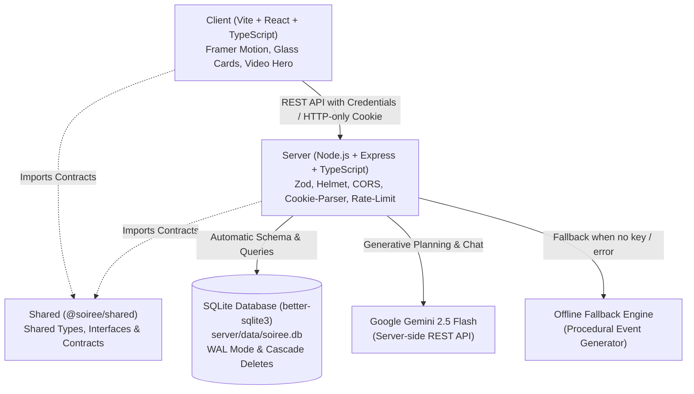

# Soirée — GenAI Luxury Event Orchestration & Fullstack Planner
> **PromptWars Challenge 5 Submission** — A fullstack event planning platform for weddings, milestone birthdays, and community gatherings, powered by Node.js, Express, TypeScript, SQLite, and Google Gemini GenAI.

---

## Overview

**Soirée** transforms event briefs into comprehensive celebration plans featuring:
- **Intelligent Budgeting**: Category-wise cost allocation with real-time spend tracking and percentage balancing.
- **Dynamic Milestones & Timeline**: Lead-time calibrated task deadlines with optimistic completion toggles.
- **Curated Vendor Management**: Shortlisting, status pipelines (To contact, Contacted, Booked), and custom budget estimates.
- **Personalised Idea Deck**: Creative themes, ceremonies, menus, entertainment, and guest experience ideas.
- **Ask Soirée (AI Event Concierge)**: Context-aware interactive assistant grounded on the event's actual budget, vendors, and schedule.
- **One-Click Calendar Sync**: Direct RFC 5545 `.ics` export importing all milestone deadlines straight into Google Calendar, Apple Calendar, or Outlook.
- **Zero-Friction Evaluation**: 1-click **"Continue as Guest"** demo mode allowing judges to test every feature instantly without filling out a signup form.
- **Resilient Offline Architecture**: 100% operational with **NO API key required** via an intelligent procedural planning engine.

---

## Architecture

The project is structured as a clean **npm workspaces monorepo**:



### Directory Structure

```
soiree/
├── client/                     # Vite + React + TypeScript frontend
│   ├── public/media/           # Optimized hero video assets (hero.mp4, hero.webm, poster)
│   ├── src/
│   │   ├── components/         # Landing, Navbar, Dashboard, Wizard, PlanView, AuthModal
│   │   ├── lib/                # api.ts (typed fetch wrapper), utils.ts
│   │   └── index.css           # Luxury editorial styling (cream, blush, mauve, gold)
│   └── vite.config.ts          # Dev proxy (/api -> http://localhost:4000)
├── server/                     # Node.js + Express + TypeScript backend
│   ├── src/
│   │   ├── db/                 # better-sqlite3 connection & schema migrations
│   │   ├── middleware/         # JWT auth, cookie management, error handler
│   │   ├── routes/             # auth, plans, health routers
│   │   ├── services/           # Gemini AI service, offline generator, ics export
│   │   ├── app.ts              # Express application configuration
│   │   └── index.ts            # Server entrypoint
│   └── tests/                  # Vitest + supertest integration test suite
├── shared/                     # Shared TypeScript contracts (@soiree/shared)
│   └── src/types.ts            # Canonical data types used by client & server
├── package.json                # Root workspaces & concurrency scripts
├── Dockerfile                  # Production container build
├── render.yaml                 # One-click Render cloud deployment spec
└── .env.example                # Example environment configuration (empty secrets)
```

---

## Quickstart Guide

### Prerequisites
- **Node.js**: v18.0.0 or higher
- **npm**: v9.0.0 or higher

No external database (Postgres, MySQL) or Docker engine is required for local development. SQLite automatically creates and migrates `server/data/soiree.db` on first run.

### 1. Install Dependencies
Run from the root directory:
```bash
npm install
```

### 2. Configure Environment (Optional)
Copy the example environment file:
```bash
cp .env.example .env
```
> **Note**: An API key is **completely optional**. If `GEMINI_API_KEY` is left blank, Soirée automatically uses its built-in offline intelligent event generator.

### 3. Run Development Server
```bash
npm run dev
```
This runs both the Express backend (`http://localhost:4000`) and the Vite client (`http://localhost:5173`) concurrently.
Open your browser to:
**[http://localhost:5173](http://localhost:5173)**

---

## Judge / Evaluation Quickstart

1. Launch with `npm run dev`.
2. On the landing page, click **"Start Planning"** or select any occasion (Wedding, Birthday, Community).
3. The app allows you to **"Continue as Guest"** in 1 click or register an account.
4. Fill in the 3-step brief (guest count, budget, location, vibe).
5. Watch Soirée compose your plan with full timeline, budget distribution, vendors, ideas, and interactive chat.
6. Try ticking a milestone, adjusting budget allocations, chatting with Soirée, and downloading the `.ics` calendar file. Everything is saved in SQLite!

---

## Production Build & Run

To build all packages with strict TypeScript checks:
```bash
npm run build
```

To run the unified production server (Express serving both the API and client bundle):
```bash
npm start
```
The app will be available at `http://localhost:4000`.

---

## Running Automated Tests

Run the backend integration test suite with Vitest:
```bash
npm test
```

### Test Coverage Highlights:
- **Authentication Flow**: Registration, duplicate prevention, password hashing, login, 1-click guest access, session verification (`/auth/me`), and logout.
- **Offline Fallback Engine**: Full event generation without credentials, validating budget math (summing to 100%), timeline scaling, and vendor estimation.
- **Data Isolation & Security**: User A's plans are strictly isolated from User B (verifying 404 responses for cross-user reads, mutations, and deletes).
- **Cascade Deletion**: Deleting a plan cleanly cascades to child milestones, budget items, vendors, ideas, and chat messages in SQLite.

---

## REST API Reference

All user-scoped endpoints enforce authentication via an `httpOnly` JWT cookie (`soiree_token`).

| Method | Endpoint | Description |
|---|---|---|
| `POST` | `/api/auth/register` | Register new account with email & password |
| `POST` | `/api/auth/login` | Sign in with email & password |
| `POST` | `/api/auth/guest` | Instant 1-click guest session for judges/evaluators |
| `GET` | `/api/auth/me` | Fetch active authenticated user session |
| `POST` | `/api/auth/logout` | Clear authentication cookie |
| `GET` | `/api/plans` | List all saved plans for the authenticated user |
| `POST` | `/api/plans` | Create a new plan from a brief (AI or offline) |
| `GET` | `/api/plans/:id` | Fetch full plan details (budget, milestones, vendors, ideas) |
| `DELETE` | `/api/plans/:id` | Delete plan and cascade remove all related entities |
| `PATCH` | `/api/plans/:id/budget/:itemId` | Update budget allocation and spent amounts |
| `PATCH` | `/api/plans/:id/milestones/:id` | Toggle milestone completion status |
| `POST` | `/api/plans/:id/vendors` | Add a new vendor category to the plan |
| `PATCH` | `/api/plans/:id/vendors/:id` | Update vendor name, status, estimate, tips |
| `DELETE` | `/api/plans/:id/vendors/:id` | Remove a vendor from the plan |
| `POST` | `/api/plans/:id/ideas/regenerate` | Regenerate ideas with optional steering text prompt |
| `GET` | `/api/plans/:id/chat` | Retrieve persistent chat message history |
| `POST` | `/api/plans/:id/chat` | Send question to event assistant and persist response |
| `GET` | `/api/plans/:id/export.ics` | Download standard RFC 5545 iCalendar file |
| `GET` | `/api/health` | Health check endpoint |

---

## GenAI Implementation & Offline Fallback

### 1. Server-Side Execution
All Gemini GenAI logic resides exclusively on the server (`server/src/services/ai.ts`). No API keys or credentials are ever exposed to the client or browser environment.

### 2. JSON-Mode Structured Prompts
When a Gemini key is present, calls use `responseMimeType: 'application/json'` with system instructions enforcing realistic regional budgeting, vendor pricing formulas, and timeline lead times based on the event date.

### 3. Graceful Normalization & Fallback
If Gemini encounters network issues, rate limits, or if no key is configured:
1. Soirée's procedural generator (`server/src/services/generator.ts`) synthesizes complete plans using industry-standard event ratios.
2. Percentage distributions are normalized to guarantee budget rows sum to 100%.
3. Milestones are clamped to the exact weeks remaining before the event.
4. Assistant chat falls back to deterministic expert planning heuristics.

---

## Security & Best Practices

- **Zero Secrets Committed**: Only `.env.example` with empty template values is tracked in git.
- **Strict Repository Size**: The git-tracked repository footprint is < 3 MB, comfortably below the 10 MB competition limit.
- **HTTP-Only Cookies**: JWT tokens are sealed with `httpOnly`, `sameSite: 'lax'`, preventing XSS token theft.
- **Zod Input Validation**: Every incoming payload is validated against strict Zod schemas before touching business logic.
- **SQL Injection Prevention**: All SQLite queries use parameterized prepared statements (`better-sqlite3`).
- **Security Headers & Rate Limiting**: Helmet applies hardened headers; Express Rate Limit protects against brute force and DDoS.

---

## Cloud Deployment

A production-ready `Dockerfile` and `render.yaml` are included.

### Deploying to Render
1. Push this repository to GitHub.
2. Create a new **Blueprint** service on Render and connect your repository.
3. Render will automatically read `render.yaml`, execute the build script, and launch the service.

> **Storage Notice**: On free cloud tiers (Render, Heroku, Fly.io), the SQLite database file at `server/data/soiree.db` is ephemeral and resets on cold container restarts. For persistent production deployments, attach a Persistent Disk mounted at `/app/server/data`.

---

## License
MIT License. Built for PromptWars Challenge 5.
