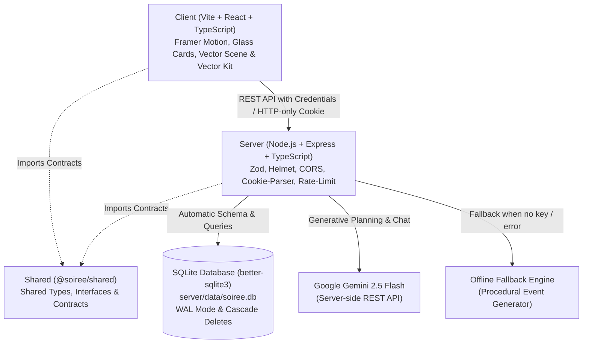

# Soirée — GenAI Luxury Event Orchestration & Fullstack Planner
> **PromptWars Challenge 5 Submission** — A fullstack event planning platform for weddings, milestone birthdays, and community gatherings, powered by Node.js, Express, TypeScript, SQLite, and Google Gemini GenAI with zero-config offline capability.

---

## Overview

**Soirée** transforms event briefs into comprehensive celebration plans featuring:
- **Intelligent Budgeting**: Category-wise cost allocation with real-time spend tracking and percentage balancing.
- **Dynamic Milestones & Timeline**: Lead-time calibrated task deadlines with optimistic completion toggles.
- **Curated Vendor Management**: Shortlisting, status pipelines (To contact, Contacted, Booked), and custom budget estimates.
- **Personalised Idea Deck**: Creative themes, ceremonies, menus, entertainment, and guest experience ideas.
- **Ask Soirée (AI Event Concierge)**: Context-aware interactive assistant grounded on the event's actual budget, vendors, and schedule.
- **One-Click Calendar Sync**: Direct RFC 5545 `.ics` export importing all milestone deadlines straight into Google Calendar, Apple Calendar, or Outlook.
- **Zero-Friction Evaluation**: 1-click **"Continue as Guest"** demo mode allowing judges to test every feature instantly without filling out a signup form.
- **Procedural Vector Engine**: Fully resolution-independent procedural SVG vector scene and vector kit with zero heavy video dependencies.
- **Resilient Offline Architecture**: 100% operational with **NO API key required** via an intelligent procedural planning engine.

---

## Vector Hero & Vector Kit

Soirée features an ultra-lightweight, resolution-independent procedural vector animation system:

### 1. Vector Hero (`VectorScene.tsx`)
- **Pure SVG Procedural Backdrop**: Replaces bulky video files with a resolution-independent, hand-crafted vector scene rendered entirely in code.
- **Layered Visual Elements**: Features a radiant glass lotus bloom, delicate gold wire ribbons, floating glass shards, shimmering pearls, gentle light rays, and drifting celestial particles.
- **Deterministic Particle RNG**: Uses a seeded pseudo-random number generator so particle coordinates and drifts remain perfectly smooth, predictable, and reproducible across client renders.
- **Performance Optimized**: Sub-15 KB footprint with zero video decoding overhead, seamless GPU acceleration, and responsive scaling across mobile and desktop viewports.

### 2. Animated Vector Kit (`Vectors.tsx`)
- **Luxury Editorial SVG Library**: A dedicated suite of bespoke SVG illustrations and micro-animations crafted specifically for luxury celebration planning.
- **Interactive Floral & Botanical Elements**: Includes `LotusBloom` with animated petal unfolding, `ScrollVine` tracing section transitions, `FloralRing`, and celebration particle bursts.
- **Celebration Motifs & Occasion Icons**: High-fidelity vector symbols including `ChampagneFlutes`, `Chandelier`, and curated occasion marks (`WeddingIcon`, `BirthdayIcon`, `CommunityIcon`).
- **Interactive Feedback**: Dynamic stroke-dasharray drawing transitions, hover states, and celestial sparkle accents that respond to user interaction.

---

## Architecture

The project is structured as a clean **npm workspaces monorepo**:



### Directory Structure

```
soiree/
├── client/                     # Vite + React + TypeScript frontend
│   ├── public/                 # Static assets (favicon.svg) - no video media
│   ├── src/
│   │   ├── components/
│   │   │   ├── VectorScene.tsx # Procedural animated SVG hero backdrop
│   │   │   ├── Vectors.tsx     # Vector kit (LotusBloom, ScrollVine, Chandelier, etc.)
│   │   │   ├── Navbar.tsx      # Responsive nav with accessible mobile drawer (<860px)
│   │   │   ├── Landing.tsx     # Landing page with hero, bento features, occasions
│   │   │   ├── Dashboard.tsx   # Saved plans management ("My Plans")
│   │   │   ├── Planner.tsx     # 3-step event wizard with VectorScene backdrop
│   │   │   ├── PlanView.tsx    # Plan overview, budget, timeline, vendors, ideas, chat
│   │   │   ├── AuthModal.tsx   # Sign in, registration, and 1-click guest access
│   │   │   └── common.tsx      # GlassCard, SectionTitle, Badge, and shared UI primitives
│   │   ├── lib/                # api.ts (typed fetch wrapper), utils.ts
│   │   └── index.css           # Luxury editorial styling (cream, blush, mauve, gold)
│   └── vite.config.ts          # Dev proxy (/api -> http://localhost:4000)
├── server/                     # Node.js + Express + TypeScript backend
│   ├── src/
│   │   ├── db/                 # better-sqlite3 connection & schema migrations
│   │   ├── middleware/         # JWT auth, cookie management, errorHandler
│   │   ├── routes/             # auth, plans, health routers
│   │   ├── services/           # Gemini AI service, offline generator, ics export
│   │   ├── app.ts              # Express application configuration
│   │   └── index.ts            # Server entrypoint with production secret validation
│   └── tests/                  # Vitest + supertest integration test suite (temp SQLite DB)
├── shared/                     # Shared TypeScript contracts (@soiree/shared)
│   └── src/types.ts            # Canonical data types used by client & server
├── package.json                # Root workspaces & concurrency scripts
├── Dockerfile                  # Production container build
├── render.yaml                 # One-click Render cloud deployment spec
└── .env.example                # Example environment configuration (empty secrets)
```

---

## Setup & Quickstart Guide

### Prerequisites
- **Node.js**: `v18.0.0` or higher
- **npm**: `v9.0.0` or higher

No external database (PostgreSQL, MySQL) or Docker daemon is required for local development. SQLite automatically provisions and migrates the database on startup.

### 1. Install Dependencies
Run from the repository root:
```bash
npm install
```

### 2. Configure Environment Variables
Copy the example environment template:
```bash
cp .env.example .env
```
*(On Windows PowerShell: `Copy-Item .env.example .env`)*

Configure variables in `.env` as desired:

| Variable | Required | Default | Description |
|---|---|---|---|
| `PORT` | Optional | `4000` | Port for Express API backend |
| `NODE_ENV` | Optional | `development` | Environment mode (`development`, `production`, `test`) |
| `JWT_SECRET` | Production only | *Dev fallback* | Secret key for signing `httpOnly` JWT session cookies. In production, startup fails if missing or unchanged from placeholder. |
| `GEMINI_API_KEY` | Optional | *Empty* | Google Gemini API key. If omitted, Soirée automatically runs the offline planning engine. |
| `GEMINI_MODEL` | Optional | `gemini-2.5-flash` | Gemini model identifier used for generative queries |

> **Offline Note**: Setting `GEMINI_API_KEY` is **completely optional**. If left blank, Soirée seamlessly uses its built-in offline intelligent event generator.

### 3. Run Development Server
```bash
npm run dev
```
This starts both the Express backend (`http://localhost:4000`) and the Vite frontend (`http://localhost:5173`) concurrently.
Open your browser to:
**[http://localhost:5173](http://localhost:5173)**

---

## Judge / Evaluation Quickstart

1. Launch the app with `npm run dev`.
2. On the landing page, click **"Start Planning"** or select any occasion (Wedding, Milestone Birthday, Community Gathering).
3. Click **"Continue as Guest"** for instant 1-click evaluation access without filling out registration credentials.
4. Fill in the 3-step brief (guest count, budget, location, vibe).
5. Watch Soirée compose your complete event plan:
   - **Interactive Budget**: Update actual spend or adjust budget categories.
   - **Milestone Timeline**: Check off milestone tasks or review lead-times.
   - **Vendor Pipeline**: Track vendor statuses from "To contact" to "Booked".
   - **Ask Soirée**: Chat with the concierge grounded in the plan's specific details.
   - **Export Calendar**: Click "Export .ICS" to download an RFC 5545 calendar import.

---

## GenAI Implementation & Offline Fallback Engine

Soirée is engineered with a **zero-failure architecture** ensuring complete functionality whether online or offline:

### 1. Server-Side Execution
All Gemini GenAI logic resides exclusively on the server (`server/src/services/ai.ts`). No API keys or credentials are ever exposed to the client or browser environment.

### 2. JSON-Mode Structured Prompts
When a Gemini API key is configured, calls use `responseMimeType: 'application/json'` with system instructions enforcing realistic regional budgeting, vendor pricing formulas, and timeline lead times based on the event date.

### 3. Graceful Offline Fallback Engine (`server/src/services/generator.ts`)
If `GEMINI_API_KEY` is omitted, or if Gemini encounters network errors or quota limits:
1. **Procedural Plan Generation**: Soirée synthesizes complete event plans using industry-standard benchmark distributions tailored to the occasion (Wedding, Milestone Birthday, Community Festival).
2. **Strict Budget Math**: Budget percentages are mathematically normalized to ensure categories always sum to exactly 100%.
3. **Calibrated Lead Times**: Milestones calculate optimal lead-time intervals (from 48 weeks down to 1 week) scaled to the exact days remaining until the event date.
4. **Curated Vendors & Negotiation Tips**: Automatically generates targeted vendor categories with estimated cost ranges and practical booking guidance.
5. **Deterministic Event Concierge**: Interactive chat falls back to heuristic domain knowledge, providing relevant advice on budget optimization, timelines, and vendor coordination without external API dependencies.

---

## Production Build & Execution

To build all packages with strict TypeScript type-checking:
```bash
npm run build
```

To run the unified production server (Express serving both the API and the compiled client bundle):
```bash
npm start
```
The application will be accessible at `http://localhost:4000`.

### Production Security Verification
When running in production (`NODE_ENV=production`):
- The server checks `JWT_SECRET`. If it is undefined or left as the default placeholder (`soiree-default-jwt-secret-do-not-use-in-real-prod`), the server **safely refuses to start** with a clear diagnostic error message.
- 5xx errors returned by the API are masked with `"Something went wrong"`, with the full error details and stack traces logged server-side only.

---

## Running Automated Tests

Run the full integration test suite with Vitest:
```bash
npm test
```

### Test Suite Highlights:
- **Zero Production DB Side-Effects**: Tests use an isolated temporary SQLite database file (`soiree-test-*.db`) in the OS temp directory, created and cleaned up before and after runs.
- **Authentication Flow**: Account registration, duplicate prevention, password hashing with scrypt, 1-click guest access, session verification (`/auth/me`), and logout.
- **Offline Event Generation**: Full plan creation without Gemini credentials, validating 100% budget math, timeline scaling, vendor allocation, and creative ideas.
- **Data Isolation & Access Control**: Verifies that User A cannot read, modify, or delete plans belonging to User B (strict 404 enforcement).
- **Cascade Deletes**: Confirms that deleting a plan cleanly cascades to child milestones, budget items, vendors, ideas, and chat history.

---

## REST API Reference

All user-scoped endpoints enforce authentication via an `httpOnly` JWT cookie (`soiree_token`).

| Method | Endpoint | Description |
|---|---|---|
| `POST` | `/api/auth/register` | Register new account with email & password |
| `POST` | `/api/auth/login` | Sign in with email & password |
| `POST` | `/api/auth/guest` | Instant 1-click guest session for judges/evaluators |
| `GET` | `/api/auth/me` | Fetch active authenticated user session |
| `POST` | `/api/auth/logout` | Clear authentication cookie |
| `GET` | `/api/plans` | List all saved plans for the authenticated user |
| `POST` | `/api/plans` | Create a new plan from a brief (AI or offline) |
| `GET` | `/api/plans/:id` | Fetch full plan details (budget, milestones, vendors, ideas) |
| `DELETE` | `/api/plans/:id` | Delete plan and cascade remove all related entities |
| `PATCH` | `/api/plans/:id/budget/:itemId` | Update budget allocation and spent amounts |
| `PATCH` | `/api/plans/:id/milestones/:id` | Toggle milestone completion status |
| `POST` | `/api/plans/:id/vendors` | Add a new vendor category to the plan |
| `PATCH` | `/api/plans/:id/vendors/:id` | Update vendor name, status, estimate, tips |
| `DELETE` | `/api/plans/:id/vendors/:id` | Remove a vendor from the plan |
| `POST` | `/api/plans/:id/ideas/regenerate` | Regenerate ideas with optional steering text prompt |
| `GET` | `/api/plans/:id/chat` | Retrieve persistent chat message history |
| `POST` | `/api/plans/:id/chat` | Send question to event assistant and persist response |
| `GET` | `/api/plans/:id/export.ics` | Download standard RFC 5545 iCalendar file |
| `GET` | `/api/health` | Health check endpoint |

---

## Security & Best Practices

- **Zero Secrets Committed**: Only `.env.example` with empty template values is tracked in version control.
- **Production Secret Guard**: Server aborts startup in production if `JWT_SECRET` is unset or equals default.
- **Production Error Masking**: 5xx exceptions return a generic message to clients while preserving detailed server logs.
- **Strict Repository Size**: The git-tracked repository footprint is < 3 MB, comfortably below competition thresholds.
- **HTTP-Only Cookies**: JWT tokens are sealed with `httpOnly`, `sameSite: 'lax'`, preventing XSS token theft.
- **Zod Input Validation**: Every incoming payload is validated against strict Zod schemas before reaching business logic.
- **SQL Injection Prevention**: All SQLite queries use parameterized prepared statements (`better-sqlite3`).
- **Security Headers & Rate Limiting**: Helmet applies hardened headers; Express Rate Limit protects against abuse.

---

## License
MIT License. Built for PromptWars Challenge 5.
